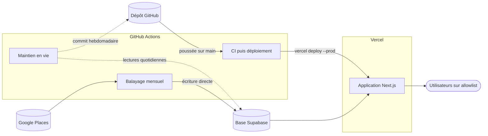

# Déploiement

> **Statut** : acté · **Dernière mise à jour** : 2026-10-17

L'outil doit tourner **sur le web, gratuitement, pour deux ou trois personnes**. Cette spec
dit où tourne quoi, comment le résultat du balayage atteint la production, et surtout ce qui
éteindrait l'outil tout seul si personne n'y prenait garde.

[`08-infrastructure.md`](08-infrastructure.md) décrit les comptes et les clés. Celle-ci
décrit ce qui s'exécute, où, et quand.

---

## Topologie

| Quoi | Où | Quand | Déclencheur |
|---|---|---|---|
| Application web | Vercel Hobby | À chaque visite | Requête d'un utilisateur |
| CI puis déploiement | GitHub Actions | À chaque poussée | Poussée + manuel |
| Base + authentification | Supabase, région Europe | En continu | — |
| Balayage | GitHub Actions | Le 1er et le 16 du mois, 09:00 UTC ([D38](../DECISIONS.md#d38--deux-passages-par-mois-le-1er-et-le-16)) | Planification + manuel |
| Purge du contenu expiré | GitHub Actions | Chaque jour à 10:23 UTC, job distinct du réveil ([D45](../DECISIONS.md#d45--purger-ce-qui-a-expiré-et-reconnaître-ce-que-google-ne-renvoie-plus)) | Planification + manuel |
| Maintien en vie | GitHub Actions | Chaque jour (base), chaque lundi (commit) | Planification + manuel |
| Ingestion SIRENE et géocodage | Poste local | Trimestriel | À la main |

**Le balayage ne tourne pas sur Vercel**, et ce n'est pas un détail de commodité. Une
fonction Hobby est plafonnée en durée, et la planification Hobby ne descend pas sous la
journée : 692 appels enchaînés n'y tiennent pas. Surtout, faire tourner le balayage dans
l'application y ferait entrer la clé Places — celle qui donne accès au palier facturé — dans
l'environnement qui sert du trafic. Elle reste dans un environnement qui n'en sert jamais.

L'ingestion SIRENE et le géocodage restent sur le poste local : 830 Mo de Parquet à filtrer
pour un travail fait une fois par trimestre, cela n'a rien à faire dans une tâche planifiée.

### Pourquoi cette séparation rend le coût prévisible

C'est la traduction en infrastructure de la décision d'architecture
([`00-architecture.md`](00-architecture.md)) : l'application ne fait **aucun** appel Google,
elle lit une base déjà remplie.

Conséquence directe : **le coût est adossé au nombre de balayages, jamais au nombre de
visites.** Dix visiteurs ou dix mille, la facture Google est identique. Un outil qui
interrogerait Google à chaque recherche aurait un coût proportionnel à son succès — ici, le
succès est gratuit.

Et comme le seul poste coûteux s'exécute à un seul endroit, sur une planification unique et
sous un plafond de quota posé chez Google, le montant à dépenser est **connu avant d'être
engagé** : 692 appels, une fois par mois, sur 1 000 gratuits.

---

## Comment le code arrive en production

**Pousser sur `main`, c'est déployer.** La poussée déclenche
[`.github/workflows/ci.yml`](../../.github/workflows/ci.yml) : un job `check` — scan de secrets,
`tsc`, tests, build — puis, s'il passe, un job `production` qui appelle le CLI Vercel. Les
autres branches obtiennent une URL de prévisualisation au lieu d'un déploiement.

Ce qui porte cette organisation tient en une ligne du fichier : le job de production déclare
`needs: check`. **Déployer un arbre rouge n'est donc pas interdit, il est impossible** — il n'y
a pas d'ordre d'opérations qui y mène, et cela ne dépend ni d'une protection de branche ni de la
discipline de qui pousse.

Deux propriétés en découlent, et la seconde répare un défaut réel de la période manuelle :

- **La production est le commit poussé.** Le workflow extrait ce SHA et le téléverse. Un
  `vercel deploy` lancé depuis un poste téléversait l'**arbre de travail** : un fichier non
  suivi que `.gitignore` ne couvrait pas devenait la production, et un arbre en retard sur
  `origin/main` annulait silencieusement les commits d'un autre. Ces deux pannes n'ont plus de
  chemin pour se produire.
- **Ce qui reste à faire à la main est ce qu'une machine ne peut pas faire.** Toutes les pages
  sont derrière le login et l'inscription est fermée (D14) : les quatre sondes automatiques
  s'arrêtent au middleware. Les pannes de D23 et de D46 étaient intermittentes et ne se voyaient
  qu'en session. La skill `deploy` ne décrit plus une mise en production, elle décrit cette
  part-là et le retour arrière.

Une exception est inscrite dans le workflow : **un changement de `lib/db/schema.ts` fait
échouer le déploiement.** La colonne ou l'enum doit exister en production *avant* que le code
qui la lit ne parte, et `drizzle/` n'est pas un état de la production. Un déclenchement manuel
(`workflow_dispatch`) contourne ce garde-fou, et c'est précisément ce qui en fait une décision :
on ne le contourne pas par inadvertance. Voir D32.

---

## Comment le résultat du balayage arrive en production

C'est la question qui revient toujours : *faut-il téléverser le résultat quelque part ?*

**Oui — et c'est l'écriture en base qui joue ce rôle.** Le balayage s'exécute dans GitHub
Actions et écrit **directement dans la base Supabase de production**. Il n'y a pas
d'artefact à récupérer, pas d'export à recopier, pas d'étape de publication : la tâche
planifiée détient l'URL de connexion à la base de production en secret de dépôt, et la
remplit elle-même.

Le job ne se limite pas à l'appel Google : il enchaîne le maillage, le balayage,
l'appariement SIRENE et le calcul des profils — la chaîne 3→6 de
[`06-pipeline-ingestion.md`](06-pipeline-ingestion.md). Ce qui atterrit en base, ce sont donc
des **profils prêts à être filtrés**, pas des horaires brutes : l'application n'a rien à
recalculer au moment de la visite.

C'est aussi le seul endroit du dépôt où le `--dry-run` posé par défaut sur tout script
consommant du quota est explicitement levé. Cette levée est une décision, elle est écrite à
un seul endroit, et elle se relit.

Trois conséquences qu'il faut avoir en tête :

- **Aucun redéploiement n'est nécessaire après un balayage.** L'application lit la base à
  chaque visite ; les nouvelles horaires sont visibles dès la fin du job. Le dépôt n'a pas
  bougé, donc Vercel ne rebâtit rien.
- **GitHub Actions est le seul endroit hors application qui écrit dans la base de
  production.** C'est aussi pour cela que le job doit échouer bruyamment : personne ne
  relit son résultat.
- **Un balayage raté ne casse pas la production.** La base garde les données du mois
  précédent, l'application continue de servir. Ce qui se dégrade, c'est l'âge de la donnée,
  et cela se voit — pas un écran d'erreur.

### Pourquoi on ne peut pas embarquer un instantané des données dans le dépôt

La tentation est réelle, et l'idée serait plus simple : commiter un export des
établissements, laisser Vercel le lire au moment du build, et se passer à la fois du secret
de base dans Actions et de la base à maintenir éveillée.

**C'est impossible ici, pour une raison qui n'est pas technique.** Les conditions
d'utilisation de Google limitent la conservation du contenu Places à **30 jours** (D7). Or
**l'historique git conserve indéfiniment** : un instantané commité aujourd'hui reste lisible
dans cinq ans, y compris s'il est retiré du dernier commit. L'effacer réellement demanderait
de réécrire l'historique et de forcer la réécriture chez tous ceux qui l'ont cloné. Le dépôt
étant **public**, ce serait de surcroît une redistribution publique de contenu Google.

La base, elle, se **remplace** : chaque balayage écrase les horaires du mois précédent, et la
donnée n'a jamais plus de 30 jours. La conformité est obtenue par construction et non par une
purge qu'il faudrait penser à appliquer — c'est exactement ce qu'acte D7, et un instantané
dans git l'annulerait.

Seul l'identifiant de lieu Google est stockable sans limite de durée. Il ne permet pas, à lui
seul, de reconstituer un annuaire.

> Le même raisonnement interdit d'archiver la réponse brute du balayage en artefact de build,
> en pièce jointe d'exécution ou dans un espace de stockage de secours : ce n'est pas le
> support qui pose problème, c'est la durée.

---

## Les deux comptes à rebours

Les offres gratuites ne se contentent pas de plafonner : elles **éteignent ce qui ne sert
pas**. Deux mécanismes distincts s'appliquent ici, et pour un outil consulté par deux
personnes de façon sporadique, **les deux se déclencheraient**.

| Mécanisme | Seuil | Ce qui se passe | Ce qui l'évite |
|---|---|---|---|
| Mise en pause Supabase | Trop peu de requêtes utilisateur sur les 7 derniers jours — un seuil de **volume**, dont Supabase ne publie pas la valeur | Projet en pause : l'application ne répond plus. Seule une reprise **à la main, depuis le tableau de bord**, la lève ; passé le délai de restauration, le projet est perdu | « Quelques requêtes utilisateur sur la base chaque jour », selon la documentation de Supabase |
| Désactivation de la planification GitHub | 60 jours sans activité **sur le dépôt** | Le balayage mensuel cesse de se déclencher | Un **commit** |

Le premier n'attend même pas une semaine de vacances : en octobre 2026, le projet s'est mis
en pause **trois jours** après une connexion réussie. Le second se déclenche en deux mois
sans commit — ce qui, sur un projet personnel arrivé à maturité, est une durée ordinaire.

**Le piège du premier est qu'une pause ne se répare pas en se connectant.** Le pooler ne
reconnaît plus le projet — `(ENOTFOUND) tenant/user … not found` — et le maintien en vie peut
donc empêcher une pause, jamais la lever.

**Le piège du second est qu'il est contre-intuitif** : une exécution de workflow **ne compte
pas** comme activité du dépôt. Seul un commit compte. Le balayage mensuel ne se maintient
donc pas lui-même — il se coupe l'herbe sous le pied, silencieusement, au bout du deuxième
mois.

### Un workflow, deux tâches sur deux rythmes

[`.github/workflows/keepalive.yml`](../../.github/workflows/keepalive.yml) porte deux jobs
indépendants :

1. **Chaque jour, des lectures réelles sur les tables de l'application**, par les deux voies
   que nomme la documentation de Supabase :
   - *les requêtes de l'application connectée* — Postgres par le pooler, comme l'application
     et le balayage : un comptage sur `restaurant`, un sur `cell`, la fin de la dernière
     exécution du balayage ;
   - *les appels à l'API du projet* — trois requêtes sur la Data API, avec la clé
     publishable. Toutes les tables ont la RLS activée sans politique : la requête
     s'exécute, et ne lit rien.
2. **Chaque lundi, un commit d'horodatage** dans un fichier dédié — c'est le commit qui
   compte, pas son contenu. Un commit quotidien noierait l'historique sous les horodatages.

**Pourquoi chaque jour, et pourquoi pas `select 1`.** Le 1er octobre 2026, le balayage a
envoyé des milliers de requêtes par le pooler ; le 5, le maintien en vie a réussi son
`select 1` ; le projet était en pause avant le 8. Une rafale ne couvre donc pas la semaine,
et la documentation ne dit pas si le trafic du pooler compte comme requête utilisateur. Le
rythme quotidien répond à son « chaque jour », l'appel à l'API à ses « appels à l'API du
projet ». Voir D35.

**Pourquoi deux jobs.** Tant que le réveil et le commit étaient deux étapes d'un même job,
une base en pause faisait échouer le réveil, et le commit qui le suivait ne partait plus :
aucun commit depuis le 5 octobre 2026, le compteur GitHub courait à cause d'une panne
Supabase. Séparés, une base en pause n'arrête plus que ce qui la concerne.

Un déclenchement manuel n'a pas de planification : il lance les deux jobs, et vérifie d'un
coup toute la chaîne.

> Le balayage mensuel réveille lui aussi la base, mais une fois par mois, et octobre a
> montré qu'une rafale ne tient pas la semaine. Il ne remplace pas les lectures quotidiennes.

**Ce workflow n'a aucun effet visible : c'est exactement ce qui le rend fragile.** La
prochaine personne qui fera le ménage le prendra pour un résidu et le supprimera — la base
s'éteindra alors en quelques jours, le balayage en deux mois, sans que rien ne renvoie à la
cause. D'où deux précautions : son
en-tête explique les deux compteurs en toutes lettres, et le fichier d'horodatage qu'il
produit renvoie lui-même à cet en-tête.

Le commit est poussé sous l'identité du robot GitHub. Un push authentifié de cette manière ne
redéclenche aucun workflow : pas de boucle possible.

**Ce n'est plus ce qui empêche le redéploiement hebdomadaire, et c'est délibéré.** L'argument
reste vrai, mais il est implicite, et il ne protégerait plus rien le jour où le déploiement
passerait par un consommateur de webhook — l'App GitHub Vercel, par exemple, à qui GitHub
transmet l'événement quelle que soit l'identité qui pousse. Le workflow de déploiement inscrit
donc `.github/last-activity.txt` dans son `paths-ignore` : la garantie est écrite, et elle se
relit à l'endroit où elle s'applique.

---

## Les limites des offres gratuites, et ce qui se passe quand on les atteint

| Service | Limite | Ce qui se passe si on l'atteint | Coût |
|---|---|---|---|
| **Google Places** | 1 000 appels Enterprise par mois | **C'est facturé**, dès le premier appel au-delà. Il n'y a aucun crédit de secours sur ce compte | Le seul poste à risque |
| **Google Places** | Plafond journalier posé à la main : 800 | `HTTP 429`, l'appel échoue | 0 € — c'est un mur, pas un seuil |
| **Supabase** | 500 Mo de base | Écritures refusées | 0 € — quelques dizaines de Mo suffisent ici |
| **Supabase** | Pause sur trop peu de requêtes dans la semaine | L'application ne répond plus ; seule une reprise à la main depuis le tableau de bord la lève | 0 € |
| **Vercel Hobby** | 100 Go de bande passante par mois | Déploiements suspendus jusqu'au mois suivant | 0 € — hors d'atteinte à cette échelle |
| **Vercel Hobby** | Usage strictement non commercial | Suspension du compte | Sans objet tant que l'accès reste sur liste fermée (D11) |
| **GitHub Actions** | Minutes illimitées sur dépôt public | — | 0 € |

**Une seule de ces lignes coûte de l'argent**, et il faut être précis sur ce qui la protège :

- Le plafond journalier de 800 appels borne un **emballement à l'intérieur d'une exécution** :
  une boucle accidentelle échoue au lieu de facturer.
- Ce qui borne le **total mensuel**, c'est autre chose : le balayage n'est planifié qu'une
  fois par mois, et le script refuse de rejouer un balayage réussi depuis moins de 25 jours.
  Un déclenchement manuel de trop ne dépense donc rien.

> **Remplacé par D28 puis D38 — à corriger à la mise en œuvre.** Le plafond journalier vaut
> 1 000, pas 800 (`02`, *posés et vérifiés*). Le total mensuel est borné par le **plafond de la
> période** — 900 appels par mois du Pacifique, toutes exécutions confondues (D28) —, pas par la
> planification. D38 planifie deux passages, le 1er plafonné à 450 et le 16 sur le reste, et
> retire le refus des 25 jours, qui bloquerait le second. Un déclenchement manuel de trop
> dépense donc ce que la période permet encore, jamais au-delà.

Les deux protections sont nécessaires. Le plafond journalier seul autoriserait 24 000 appels
sur un mois ; la règle des 25 jours seule ne protégerait pas d'une boucle.

Voir [`02-budget-google-et-garde-fous.md`](02-budget-google-et-garde-fous.md) pour le modèle
tarifaire complet.

---

## Étape intermédiaire : mettre le POC en ligne

Décidé le 2026-08-29. Il ne s'agit pas encore de la mise en production décrite plus bas,
mais d'une mise en ligne du prototype, **sur les seules données de démonstration**.

**Ce qui est déployé** : 37 établissements **fictifs**, avec le bandeau qui le dit à
l'écran. Aucune donnée Google réelle n'est en base.

**Ce qui n'existe pas encore** : l'authentification. Il n'y a ni route de connexion, ni
allowlist — la page est publiquement accessible.

C'est acceptable *tant que la base ne contient que de la fiction*, et cela permet de faire
dès maintenant le test de lisibilité prévu en
[`fonctionnel/02`](../fonctionnel/02-recherche-carte-liste.md) : faire lire l'écran à la
personne concernée.

> ⚠️ **La ligne à ne pas franchir.** Le login devient bloquant **avant le premier balayage
> réel**, pas avant. Une page publique alimentée par des données Places serait exactement
> l'annuaire public que les CGU Google interdisent, et que D11 écarte. Charger de vraies
> données sur un déploiement sans authentification annulerait d'un coup les précautions
> prises depuis le début.

Pour cette étape : créer le projet Supabase, y appliquer le schéma, y jouer `seed`,
importer le dépôt sur Vercel avec `DATABASE_URL` et
`NEXT_PUBLIC_GOOGLE_MAPS_API_KEY`, puis compléter la restriction par référent de la clé
Maps avec le domaine attribué. Les points 5 à 8 et 11 à 17 ci-dessous ne s'appliquent
qu'à la vraie mise en production.

---

## Ce qu'il reste à faire, dans l'ordre

Actions manuelles, hors du dépôt. Le repère ⚠️ signale ce qui protège du coût ou de la perte
de données.

> **Prérequis** : les scripts d'ingestion décrits en
> [`06-pipeline-ingestion.md`](06-pipeline-ingestion.md) doivent être écrits et validés en
> local. La mise en production les exécute, elle ne les remplace pas.

### Supabase
1. Créer le projet, **région Europe**, activer l'extension `pg_trgm`
2. Authentification : lien par email, **inscription désactivée** (D14)
3. Appliquer le schéma à la base de production — **avant** tout balayage, sinon le premier
   job échoue sur des tables absentes
4. Relever les URL de connexion. ⚠️ **Attention au mode de connexion** : sur l'offre
   gratuite, la connexion directe n'est joignable qu'en IPv6, dont les runners GitHub ne
   disposent pas. Le balayage doit donc passer par le connecteur mutualisé, en mode
   **session** — le mode transaction convient à l'application, pas à un script batch qui
   ouvre une connexion longue. Et l'application n'y fait passer qu'une instruction à la fois,
   toutes requêtes confondues (D23, D46)

### GitHub
5. ⚠️ Configurer l'identité git du dépôt sur l'adresse `noreply`, **avant le premier push** —
   après, l'adresse est publique et définitive
6. ⚠️ Activer la **protection au push** — sur un dépôt public, un secret commité par erreur
   est moissonné en quelques minutes
7. Créer les secrets de dépôt : clé Places, URL de la base **de production**, et
   `VERCEL_TOKEN` — un jeton créé côté Vercel, sur l'équipe qui porte le projet. C'est lui qui
   autorise le déploiement depuis Actions ; son expiration se manifestera par un déploiement
   rouge, pas par une panne. Puis deux **variables** de dépôt, pas des secrets puisqu'elles
   sont publiques par construction : `SUPABASE_URL` et `SUPABASE_PUBLISHABLE_KEY`, pour les
   requêtes quotidiennes du maintien en vie sur la Data API
8. Vérifier que les workflows sont autorisés à écrire dans le dépôt — sans quoi le commit
   hebdomadaire de maintien en vie échouera

### Vercel
9. Importer le dépôt, renseigner les variables d'environnement de production — et les cocher
   aussi pour **Preview**, sans quoi les prévisualisations de branche échouent au build
10. Une fois le domaine attribué : compléter la **restriction par référent** de la clé Maps
    et les URL de redirection Supabase. ⚠️ Tant que ce n'est pas fait, la clé Maps est
    utilisable par n'importe qui. Y ajouter le motif des URL de prévisualisation, sinon la
    carte ne se charge pas sur les branches — et la panne est muette de notre côté, seul
    `gm_authFailure` la signale. ⚠️ **Vercel tronque le nom du projet** dans les noms d'hôte
    qu'il engendre : c'est `dish-my-taste-<hash>-hipopo-2684.vercel.app`, pas
    `dish-my-taste-job-…`. Un motif bâti sur le nom complet du projet ne correspond à rien,
    et il échoue exactement comme le `localhost:*` qui ne couvre aucun port

### Mise en service
11. Déclencher **manuellement le maintien en vie** — il lance ses deux jobs et vérifie d'un
    coup le secret de base, les deux variables, la joignabilité de Supabase par le pooler et
    par la Data API, et le droit d'écriture sur le dépôt, sans dépenser un seul appel Google
12. ⚠️ Valider le coût en local avec `--dry-run` **pointé sur la base de production** : le
    plan doit annoncer de l'ordre de 692 appels. Au-delà de ~800, on retravaille le maillage
    avant de dépenser
13. Déclencher **manuellement le balayage**, et le regarder aller au bout
14. Passer les contrôles de fin de cycle de
    [`06-pipeline-ingestion.md`](06-pipeline-ingestion.md) — en particulier **cellules
    tronquées non résolues = 0**
15. ⚠️ Vérifier en console de facturation : consommation Enterprise proche de 692, et
    **rien sur le palier Atmosphere**
16. Créer les comptes des utilisateurs à la main — c'est l'allowlist (D14)

### Un mois plus tard
17. Vérifier que le balayage planifié s'est bien déclenché tout seul, que les réveils
    quotidiens de la base sont verts, et que les commits hebdomadaires de maintien en vie
    sont présents. C'est le seul moyen de savoir que les
    deux comptes à rebours sont bien neutralisés.
